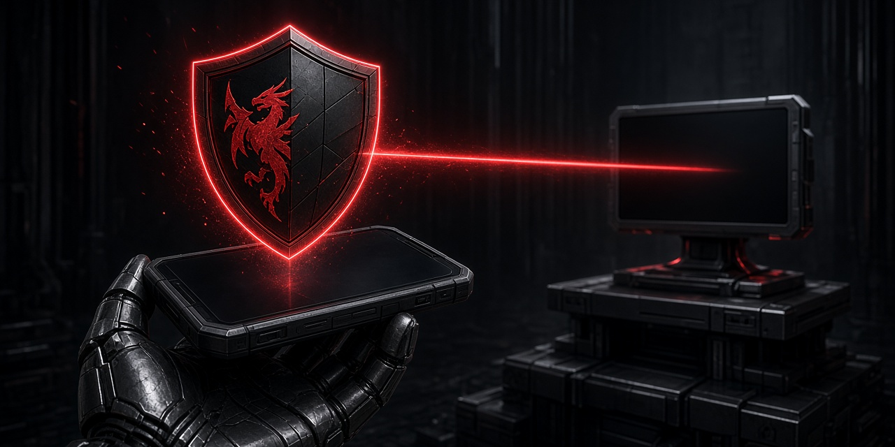

# OpenShield Pocket ⚫🛡

The **mobile port** of [OpenShield Desktop](https://github.com/Blackshield-Company/openshield-desktop)
— the Android companion for the OpenShield AI coding harness.

`com.openshield.pocket` · Android · strictly a remote — Pocket pairs to a
desktop/server `openshield serve` instance over LAN. No offline provider chat.

## What's in this repo

| Path | Contents |
|---|---|
| `src-tauri/gen/android/` | The Tauri Android target — package `com.openshield.pocket`, MainActivity, launcher icons (crest, adaptive + monochrome), gradle wiring. Mirrors the layout in the desktop repo so it drops into Tauri's standard flow. |
| `docs/POCKET.md` | Pocket design brief — pairing, security model, milestones. |

The shared SvelteKit frontend and Rust core live in
[openshield-desktop](https://github.com/Blackshield-Company/openshield-desktop)
— the same codebase serves desktop (Linux/macOS/Windows) and Pocket (Android),
platform-gated per the design doc.

## Building

Pocket is built from the desktop repo (Tauri generates the Android target via
`tauri android init`); this repo tracks and version-counters the Android-specific
source and the Pocket design.

```bash
git clone https://github.com/Blackshield-Company/openshield-desktop.git
cd openshield-desktop
# Tauri Android prerequisites (per Tauri v2 docs), then:
npm install
npm run tauri android build
```

## Status

- **M4 Pocket pairing — CODE DONE**: Android project, manual paste-payload
  pairing, app-private token storage, first-run routes to Settings. Serve
  1.1.1 returns 401 without a bearer token on every host, including loopback.
- **Next pass**: on-device install + screencap on the Android target, then
  v0.1 release packaging.

## Security model

- Token required on every request, including loopback; wildcard binds refused
  unless explicitly enabled (`lan_mode`). Minimum server: openshield 1.1.1.
- Pairing via `POST /api/v1/pair` — QR scan or manual payload entry. Payloads
  are minted with the master token on the desktop; only the master token may
  call pair (rate-limited to 5/min, returns 429).
- The app always sends the bearer token. A 401 shows a re-pair banner
  ("Unauthorized — re-pair with your OpenShield server") and routes to
  Settings; 429 surfaces "Too many pairing attempts, wait a minute".
- Tokens stored app-private, never in shared storage.
- Same WS chat envelope as desktop — one code path, two platforms. WS uses
  `?token=`.

---

MIT © 2026 Blackshield Company — the shield holds. ⚫🛡